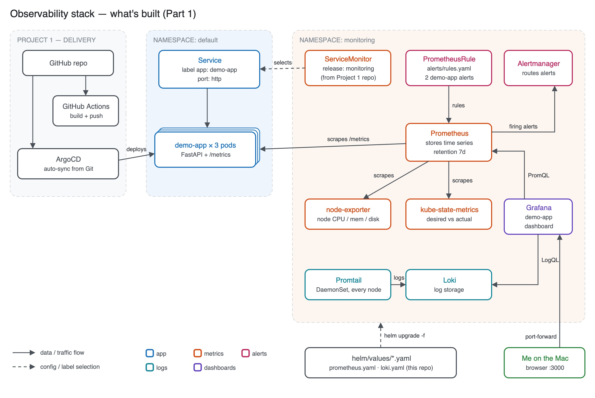

# Part 1 — What I've built so far

## 🗺️ How it fits together

- **Metrics:** Prometheus finds demo-app through ServiceMonitor → Service → pods, all matched by labels. It also scrapes node-exporter (node CPU/memory/disk) and kube-state-metrics (desired vs actual replicas).
- **Logs:** Promtail runs on every node and ships container logs to Loki.
- **Alerts:** PrometheusRule → Prometheus evaluates it → Alertmanager.
- **Seeing it:** Grafana reads both Prometheus and Loki; I reach it with a port-forward from the Mac.
- **Installed by:** Helm with values from `helm/values/`. demo-app and its ServiceMonitor come from Project 1's GitOps pipeline.

## 📝 Summary
- **Metrics:** Installed kube-prometheus-stack (Prometheus, Grafana, Alertmanager, node-exporter, kube-state-metrics, operator) with Helm into `monitoring`.
- **Logs:** Installed loki-stack (Loki + Promtail) — logs from every pod are searchable in Grafana and survive pod restarts.
- **App instrumentation:** Added `prometheus-fastapi-instrumentator` to demo-app for a `/metrics` endpoint; wired up a ServiceMonitor so Prometheus scrapes all 3 pods (`up{job="demo-app"}` = 1).
- **Dashboard:** Built `dashboards/demo-app.json` — request rate, error rate, p50/p95/p99 latency, pod CPU and memory (RED method + saturation).
- **Alerts:** `alerts/rules.yaml` with `DemoAppHighErrorRate` (>5% for 2m) and `DemoAppPodsUnavailable` (available < desired for 1m). The error-rate alert has fired for real.
- **Reproducible from the repo:** Helm values in `helm/values/` — `prometheus.yaml` with resource requests/limits sized from real usage, `loki.yaml` fixing the Grafana default-datasource clash.
- **Debugged and fixed:**
  - Grafana CrashLoopBackOff (two default datasources)
  - port-forward dying mid-rollout
  - ServiceMonitor never applied (uncommitted file / ArgoCD not synced yet)
  - latency panel stacked to 100%
  - cluster-wide restarts — undersized 2 GB workers causing OOM → slow etcd → probe failures → restart loop; fixed by resizing workers to 4 GB + adding resource requests. Verified 6 days later.
- **Biggest lessons:**
  - Restart count alone means nothing — reason + exit code + timestamp tell you if it's the app, the probe, or the node.
  - When everything is unhealthy at once, look at the nodes, not the pods.
  - In GitOps, Git is the truth — compare desired (Git) vs actual (cluster).
  - Percentiles over averages; percentiles are only as precise as the histogram buckets.
  - Resource requests are what make the scheduler honest.

## 📚 The detail

## 📊 kube-prometheus-stack
- Installed kube-prometheus-stack with Helm into a `monitoring` namespace. One chart, about six components:
- Prometheus — scrapes metrics over HTTP every 15–30s and stores them as time series
- Alertmanager — receives firing alerts and routes them (Slack, email, PagerDuty)
- Grafana — the UI for dashboards and alerts
- node-exporter — runs on every node, exposes CPU / memory / disk / network
- kube-state-metrics — exposes Kubernetes object state ("deployment wants 3 replicas, has 2")
- Prometheus Operator — lets me configure Prometheus with Kubernetes YAML (`ServiceMonitor`, `PrometheusRule`) instead of editing Prometheus config files. Same reconcile-loop idea as ArgoCD.
- Had cluster and node dashboards straight away with zero app instrumentation — that's infrastructure metrics vs application metrics.

## 🔌 Getting kubectl + Helm working from the Mac
- `helm` wasn't installed — `brew install helm`. Installed globally, so it doesn't matter which folder I was in.
- kubectl on the Mac had no cluster configured (`current-context is not set`). Copied kubeadm's admin kubeconfig off the control plane:
- `multipass exec k8s-control -- sudo cat /etc/kubernetes/admin.conf > ~/.kube/config`
- Running tools from the Mac (not inside the VM) matters for port-forward — the tunnel opens on the machine running the command, so it has to be the machine with the browser.
- Never commit that kubeconfig — it's full cluster-admin.

## 📜 Loki + Promtail
- Installed `grafana/loki-stack` with Promtail enabled.
- Promtail is a DaemonSet (one per node) that tails container log files and ships them to Loki with Kubernetes labels attached.
- Loki only indexes labels, not the full log text — much cheaper than Elasticsearch, slower for full-text search.
- Logs survive the pod — `kubectl logs` doesn't once a pod is replaced.
- Note: loki-stack is deprecated and Promtail is end-of-life; Grafana Alloy is the replacement. Fine for learning, but I'd use Alloy in production.

## 🐛 Debugging: Grafana in CrashLoopBackOff
- Went to reconnect to Grafana and it had restarted 308 times in 45 hours.
- `kubectl logs` showed the actual error on the last line:
- `Datasource provisioning error: ... Only one datasource per organization can be marked as default`
- Both kube-prometheus-stack (Prometheus) and loki-stack (Loki) register themselves as Grafana's default datasource. Grafana refuses to start with two.
- Fixed by setting `loki.isDefault: false` in `helm/values/loki.yaml` and running `helm upgrade -f`, then restarting Grafana.
- Gotcha: `helm upgrade -f` replaces earlier `--set` values, it doesn't merge — had to put `promtail.enabled: true` in the file too, or promtail would have been switched off.
- Lesson: values belong in files in the repo, so the repo is the record of what's actually deployed.
- Lesson: "can't connect" is often "the pod is dead". `kubectl get pods` → STATUS / RESTARTS → `kubectl logs` comes first.

## 🧪 Instrumenting demo-app
- Added `prometheus-fastapi-instrumentator` to `app.py` and `requirements.txt` in the Project 1 repo:
- `.instrument(app)` — middleware that times and counts every request by handler, method, status
- `.expose(app)` — adds a `/metrics` route that serves those numbers as plain text
- (First tried pasting the Python into the terminal — it's code for the app, not shell commands.)
- Pushed → GitHub Actions built the image → ArgoCD rolled it out. Project 1 doing its job.

## 🐛 Debugging: port-forward dying during a rollout
- `curl localhost:8080/metrics` gave `Empty reply from server`, then `network namespace for sandbox ... is closed`.
- `port-forward svc/...` doesn't really go through the Service — it picks one pod and tunnels to it. I'd opened it mid-rollout, and that pod got terminated.
- Also learned port-forward blocks the terminal — the curl on the next line never ran until the tunnel died. Tunnels go in their own tab.
- Lesson: `kubectl get pods` (look at AGE) and `kubectl get rs` tell you if a rollout is still happening. Old ReplicaSets at 0 replicas are the rollout history `kubectl rollout undo` uses.

## 🎯 Getting Prometheus to scrape the app
- The CLAUDE.md said Prometheus "scrapes automatically" — it doesn't with kube-prometheus-stack. Needed a ServiceMonitor.
- Changes in the Project 1 repo:
- Added `labels: app: demo-app` to the Service and named the port `http`
- Wrote `k8s/servicemonitor.yaml` with `release: monitoring` label (Prometheus ignores ServiceMonitors without it)
- The chain: Prometheus → ServiceMonitor (`release: monitoring`) → Service (`app: demo-app`) → pods → port `http` at `/metrics`. All wired together by labels.

## 🐛 Debugging: ServiceMonitor not appearing
- Wrote the file, nothing happened. It was never committed — untracked on my laptop. In GitOps the file on your laptop doesn't count; Git is the source of truth.
- After pushing, still `No resources found`. Compared commit hashes: GitHub had my commit, ArgoCD had last synced the one before.
- ArgoCD polls GitHub (~3 min) — it can't get a webhook because the cluster is on my laptop. Forced it with the refresh annotation.
- Confirmed with `up{job="demo-app"}` = 1 for all 3 pods.
- Lesson: compare desired state (Git) against actual state (cluster) — that's how you debug GitOps.

## 📈 Dashboard
- Built a `demo-app` dashboard, exported to `dashboards/demo-app.json`:
- Request rate — `sum by (handler) (rate(http_requests_total{job="demo-app", handler!="/metrics"}[5m]))`
- Error rate — 4xx|5xx rate ÷ total rate (a ratio, not a count)
- Latency p50 / p95 / p99 — `histogram_quantile` over `http_request_duration_highr_seconds_bucket`
- CPU — `container_cpu_usage_seconds_total` per pod
- Memory — `container_memory_working_set_bytes` per pod
- Request rate + errors + duration = the RED method. CPU + memory = saturation. Together: Google's four Golden Signals.
- Generated traffic with a curl loop hitting `/`, `/health` and `/does-not-exist` (for 404s) — empty graphs teach nothing.
- Why percentiles not averages: 99 requests at 10ms and 1 at 5s averages to ~60ms and hides the one user in 100 who's suffering.
- Why `rate()`: counters only ever go up. `rate()` turns "total since boot" into "per second right now".

## 🐛 Debugging: latency panel showing 0–100%
- Latency panel had a y-axis of 0–100% with p99 pinned flat at the top.
- Real values from Prometheus were fine: p50 5ms, p95 9.6ms, p99 10ms.
- Cause: Stack series was set to 100% — draws each line as a share of the total, so the top series always hits 100%. Percentiles must never be stacked (p99 already includes p50).
- Fixed: Stack series Off, unit seconds, fill opacity 0.

## 🔍 Things the data showed me
- `/metrics` is the slowest endpoint in the app (~17.7ms avg vs ~1ms for `/`). Prometheus's own scrapes push p95/p99 up — the monitoring affects the thing being monitored. The `highr` histogram has no handler label, so they can't be filtered out of the latency panel.
- p99 sat at exactly 10ms because the smallest histogram bucket is ≤10ms and almost everything lands in it. `histogram_quantile` can only interpolate inside a bucket — percentiles are only as precise as your bucket boundaries.
- CPU stepped up from ~0.002 to ~0.015 cores exactly when the curl loop started — traffic and saturation moving together.
- Memory steady at ~35 MiB against a 128Mi limit — headroom, no leak.

## 🚨 Alerts
- Wrote `alerts/rules.yaml` as a `PrometheusRule` (with `release: monitoring` label), applied with `kubectl apply`:
- `DemoAppHighErrorRate` — error ratio > 5% for 2m, severity warning
- `DemoAppPodsUnavailable` — available replicas < desired replicas for 1m, severity critical
- `for: 2m` stops a single blip from paging someone — first defence against alert fatigue.
- Didn't use `up == 0` for "pod down": a deleted pod's target disappears rather than reporting 0, so that alert would never fire. Desired vs available replicas (from kube-state-metrics) catches both crashed and missing pods.
- `DemoAppHighErrorRate` has fired — the curl loop runs ~33% 404s, well over 5%.
- Alerts went inactive once the curl loop stopped — no traffic means no errors.

## 🔕 Built-in alerts firing on a fresh install
- Alert rules page showed ~10 firing alerts I didn't write.
- Watchdog — fires forever on purpose. A dead man's switch: if it ever stops arriving, the alerting pipeline itself is broken.
- The rest (etcdMembersDown, TargetDown, KubeScheduler / ControllerManager / Proxy Unreachable) — 6 targets down:
- kube-proxy on all 3 nodes (:10249), kube-controller-manager (:10257), kube-scheduler (:10259), etcd (:2381)
- Cause: kubeadm binds those components' metrics to 127.0.0.1. Prometheus runs in a pod, so it can't reach the node's localhost. The components are healthy — just invisible.
- Lesson: 10 alerts firing and none of them real is alert fatigue in miniature. Fixing or silencing noisy alerts is part of setting up alerting.

## 🗂️ prometheus.yaml was empty for a reason
- `helm get values monitoring -n monitoring` → `USER-SUPPLIED VALUES: null`. I installed kube-prometheus-stack with pure defaults, so there was nothing to copy into the file — the values have to be decided, not exported.
- `helm list -n monitoring` shows the chart version (`kube-prometheus-stack-91.8.1`). Always pass `--version` on `helm upgrade`, otherwise it pulls the latest chart and you get an unplanned upgrade along with your values change.

## 🐛 Debugging: restarts everywhere
- Two different restart patterns, found by comparing `lastState.terminated` (reason, exit code, finish time) across pods:
- `kubectl get pods -n monitoring -o custom-columns='POD:.metadata.name,RESTARTS:.status.containerStatuses[*].restartCount,REASON:.status.containerStatuses[*].lastState.terminated.reason,EXIT:.status.containerStatuses[*].lastState.terminated.exitCode,FINISHED:.status.containerStatuses[*].lastState.terminated.finishedAt'`

- Pattern 1 — whole-cluster event (one-off):
- demo-app (all 3 pods, both workers), kube-apiserver, etcd, Alertmanager, Promtail all died at 23:11:42–45 on Oct 27 with `Reason: Unknown, Exit Code: 255`.
- Exit 255 / Unknown = the container runtime lost track of the container — what a node/VM restart looks like, not an app crash. Everything at the same second on different nodes = the cause is below Kubernetes (Mac sleeping / Multipass pausing the VMs).
- Not OOMKilled — demo-app is fine at ~35Mi of 128Mi.

- Pattern 2 — ongoing, still happening:
- operator 171, kube-state-metrics 106, node-exporter 13 / 44 / 59, loki 18 restarts.
- Exit 143 = SIGTERM — the kubelet killed them. kube-state-metrics' last words: `Failed to contact API server for /livez`.
- `kubectl get events -A --sort-by=.lastTimestamp | grep -vi normal` showed the chain:
  - `SystemOOM` on k8s-worker1, victim process: grafana. Workers have 2 GB RAM, ~42 MB free.
  - etcd: `apply request took too long` — 500ms+ vs 100ms expected. API server traces show etcd calls taking 1–4s.
  - Liveness/readiness probes timing out (`context deadline exceeded`) on loki, grafana, kube-state-metrics, operator, flannel, ArgoCD.
- Root cause: undersized VMs. Starved node → slow etcd/API → probes time out → kubelet restarts the pod → restart adds more load → repeat.
- kube-apiserver has 1,716 restarts in total — this has been going on for a long time unnoticed.
- Lesson: restart count alone tells you nothing — reason + exit code + timestamp tell you whether it's the app, the probe, or the node.
- Lesson: when everything is unhealthy at once, stop looking at pods and look at the nodes.
- Lesson: `kubectl describe pod` without `-n` only shows the `default` namespace.
- Lesson: `kubectl top nodes` → `Metrics API not available` — kube-prometheus-stack doesn't install metrics-server; that API is separate from Prometheus.

## 📏 Sizing resources from real data
- Wrote `helm/values/prometheus.yaml` with resource requests/limits for every component, sized from Prometheus's own data instead of guessing:
- `max by (pod,container) (max_over_time(container_memory_working_set_bytes{namespace="monitoring"}[1d]))`
- Prometheus ~285Mi, Grafana ~320–420Mi (+ ~75Mi per sidecar), operator ~80Mi, kube-state-metrics / Alertmanager ~50Mi, node-exporter ~10–27Mi.
- Rule used: request ≈ normal usage, memory limit ≈ 2x headroom. Retention cut to 7d.
- No CPU limits on purpose — a CPU limit throttles the container even when the node has spare CPU. Requests are what the scheduler uses.
- Checked it before applying with `helm template ... -f helm/values/prometheus.yaml` — renders the manifests locally so you can see the values landed in the right place.
- Saw two Grafana pods in the 1-day query and thought it was a stuck rollout — it was the old pod the OOM killed, still inside the query window. `kubectl get rs` showed only one live ReplicaSet.
- Lesson: requests are what make the scheduler honest — without them it thinks every pod is free and packs a 2 GB node until the kernel starts killing things.

## 🔧 Fix applied: bigger workers + resource requests
- Resized both workers 2 GB → 4 GB (`multipass stop` / `multipass set local.k8s-worker1.memory=4G` / `multipass start`), then `helm upgrade ... --version 91.8.1 -f helm/values/prometheus.yaml` (revision 3).
- After: workers ~2.6–2.7 GB available (was ~42 MB). All monitoring pods Running, 0 restarts, nothing Pending. Requests now 18–20% of worker memory, so the scheduler has real numbers to work with.
- Warnings right after the reboot were startup noise, not new problems: flannel `subnet.env` missing (flannel not up yet when pods tried to start) and Grafana readiness `connection refused` while it booted.
- No new `SystemOOM` since the resize.
- Not fixed yet: etcd still logs `took too long` (62 in 5 min, up to ~1s) — some is restart churn, but etcd is on the control plane, which already had 4 GB. Memory may not be its bottleneck — suspect slow disk fsync on the VM.
- Loki isn't part of kube-prometheus-stack — still no resource requests, 19 restarts. Needs the same treatment in `helm/values/loki.yaml`.

## ✅ Checked: the node fix held (Nov 9)
- 6 days after the resize, pods showed new restarts — but every one finished at the same second (2026-11-08 20:50:42) with `Reason: Unknown, Exit Code: 255`.
- Same signature as Oct 27: the VMs paused/restarted (Mac sleep), not the cluster starving. No `SystemOOM` events, all nodes Ready.
- etcd `took too long`: 6 in 15 min (was 62 in 5 min) — the slowness was mostly memory pressure + restart churn, not disk.
- Lesson: same restart count, different story — checking reason + exit code + timestamp stopped me from "fixing" memory again.

---

# Part 2 — Next steps

## ⏳ 1. Loki values
- Add resource requests to `helm/values/loki.yaml` for Loki + Promtail (loki-0 at 25 restarts).
- Size from `max by (pod, container) (max_over_time(container_memory_working_set_bytes{namespace="monitoring", pod=~"loki.*", container!=""}[7d]))`.
- Apply with `helm upgrade loki grafana/loki-stack --version 2.10.3 -n monitoring -f helm/values/loki.yaml`.

## ⏳ 2. Test `DemoAppPodsUnavailable`
- A bad image tag won't fire it: the rolling update keeps all 3 old pods up while the new one sits in `ImagePullBackOff`, so available still = desired. (ArgoCD self-heal may also revert a manual `kubectl set image`.)
- Instead: `kubectl cordon` both workers → delete one demo-app pod → replacement stays Pending → 2/3 available → fires after 1m. `kubectl uncordon` → resolves.
- Screenshot Firing and Resolved for the README.

## ⏳ 3. Fix the kubeadm metrics targets
- Change `--bind-address=127.0.0.1` → `0.0.0.0` in the controller-manager and scheduler static pod manifests, `--listen-metrics-urls` → `http://0.0.0.0:2381` for etcd, and `metricsBindAddress: "0.0.0.0:10249"` in the kube-proxy ConfigMap.
- Back up `/etc/kubernetes/manifests` to somewhere *outside* that folder first — the kubelet loads any file in it.
- Trade-off: exposes metrics on the node network. Fine in a lab; in production restrict with firewall / network policy and set it in the kubeadm config so upgrades don't revert it.

## ⏳ 4. Investigate the latency spike
- p99 jumped to ~9s (peak in Prometheus ~6s at 5m resolution) when it's normally ~10ms. Haven't found the cause yet.
- Plan: zoom the dashboard to the spike → check request rate / CPU throttling / node memory in that window → Loki `{app="demo-app"}` for the same window → look for gaps in `up{job="node-exporter"}` (a VM pause shows as missing data everywhere at once).
- Most likely: a VM pause (Oct 27 23:11 or Nov 8 20:50) or the node starvation from "restarts everywhere". Requests in flight during a VM freeze count the frozen time as latency.
- Retention is 7d — if the spike is older, the data is gone; say so in the write-up.
- Write up as: symptom → what I checked → what the data showed → root cause.
